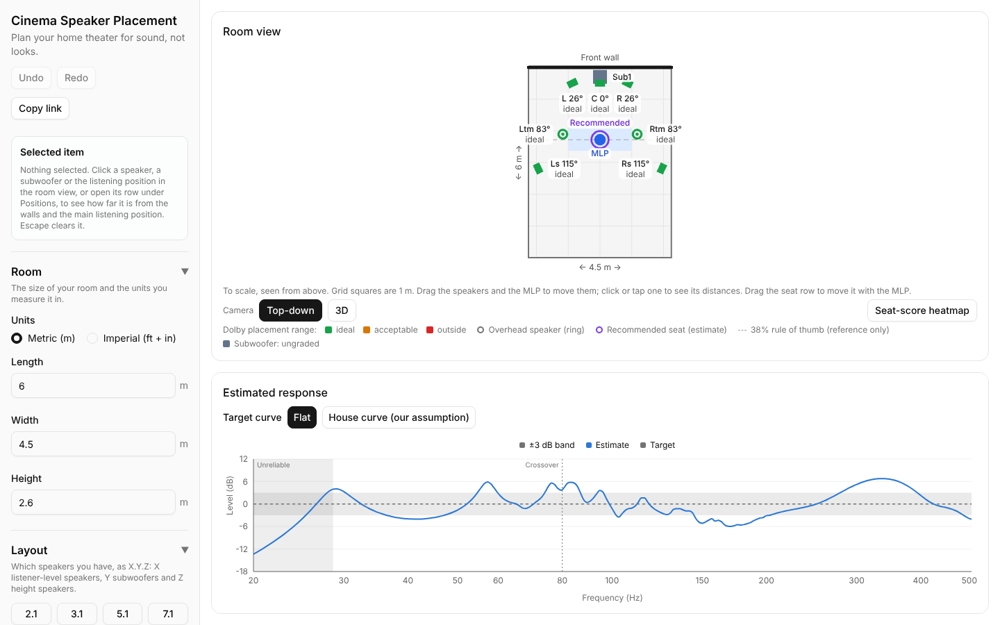

# Cinema Speaker Placement

Plan a home theater room for **sound, not looks**. Enter your room and speaker layout (5.1, 7.1.4, ...), get Dolby-guided speaker and seating placement, drag things around, see an estimated frequency response at your seat, and share the whole setup as a link.

**Try it: https://skcon.github.io/cinema-speaker-placement/**



See [CLAUDE.md](CLAUDE.md) for the project brief and architecture, [GLOSSARY.md](GLOSSARY.md) for domain terms, [docs/workflow.md](docs/workflow.md) for how we work and [CHANGELOG.md](CHANGELOG.md) for releases.

## Features

- **Your room, your layout**:
  - a rectangular room in meters or feet and inches
  - layouts 2.1, 3.1, 5.1, 7.1, 5.1.2, 5.1.4, 7.1.2 and 7.1.4
  - 1–4 subwoofers (for example `7.2.4`)
- **Auto-place from Dolby's guidelines**:
  - listener-level speakers at Dolby's azimuth ranges: the front stage near the front wall, the surrounds at the side or back walls, with the receiver's distance setting evening out the arrival times
  - overhead speakers at Dolby's elevation angles and spacing
  - subwoofers in published multi-subwoofer arrangements
  - every range cites its source
- **Placement-range grades**: each speaker is ideal, acceptable or outside on its angle (and elevation for overhead speakers) from the main listening position (MLP).
- **Room view**:
  - a top-down floor plan where you drag speakers, subwoofers and the MLP
  - a 3D view you can orbit to see overhead speakers in space
  - a seat row, the 38% rule of thumb as a reference, and a seat-score heatmap
- **Estimated response at the MLP**:
  - room modes, boundary interference, crossover and subwoofer roll-off, against a flat or house target curve
  - weaknesses and strengths listed with their likely cause
- **Recommended seat** from a grid of candidate seats scored on bass smoothness and placement fit, and "Move MLP here".
- **Headroom check**: whether your speakers and amplifier can reach reference level at the MLP.
- **Share links**:
  - the whole plan lives in the URL, so copying the address shares the room
  - links keep working after updates
  - recent rooms are remembered in your browser
- **Undo and redo** for moves and layout changes.

## Limitations

- **Estimates, not measurements.** The acoustic model is simplified (ADR 0002): low-frequency room modes, boundary interference for listener-level speakers, and angle checks. It is not a full-band simulation, and a real room needs measuring (for example with REW).
- **Rectangular rooms only.** No doors, windows, openings, furniture or room treatment.
- **The layouts above only.** No 9.1.x or larger, no Atmos-enabled (up-firing) or hybrid height layouts (a hint suggests them for low ceilings), no wall-mounted front or rear height speakers, and at least one subwoofer.
- **One seat analyzed.** The analysis runs at the MLP only; the seat row is drawn, not analyzed.
- **No dragging in 3D.** The 3D view is view only.
- English only, and no library of real speaker models.

## Quickstart

You need Node 22 (22.13 or a later 22.x) and npm. `.nvmrc` selects Node 22 for `nvm use` and CI, and `engines` in `package.json` requires `^22.13.0`.

```bash
npm install
npm run dev          # http://localhost:5173
```

Before the first end-to-end run, install Playwright's browser once:

```bash
npx playwright install chromium
```

## npm scripts

| Script                 | What it does                                                                                  |
| ---------------------- | --------------------------------------------------------------------------------------------- |
| `npm run dev`          | Start the Vite dev server with hot reload.                                                    |
| `npm run build`        | Typecheck, then build the static site into `dist/` for the `/cinema-speaker-placement/` path. |
| `npm run preview`      | Serve the production build at http://localhost:4173/cinema-speaker-placement/.                |
| `npm run typecheck`    | Run the TypeScript compiler (`tsc -b`) without emitting.                                      |
| `npm run lint`         | Run ESLint, including the layer-boundary rules from CLAUDE.md.                                |
| `npm run format`       | Format the code with Prettier.                                                                |
| `npm run format:check` | Check formatting without changing files (used in CI).                                         |
| `npm test`             | Run the Vitest unit tests once.                                                               |
| `npm run test:watch`   | Run Vitest in watch mode.                                                                     |
| `npm run test:e2e`     | Build, serve the preview and run the Playwright smoke test.                                   |

## Project layout

| Path                                                                                          | Layer        | Contents                                                                                              |
| --------------------------------------------------------------------------------------------- | ------------ | ----------------------------------------------------------------------------------------------------- |
| `src/domain`                                                                                  | Domain       | Pure TypeScript: rooms, layouts, placement, acoustics, codec. Public API in `index.ts`.               |
| `src/state`                                                                                   | State        | Zustand store(s) that hold the config and call the domain.                                            |
| `src/ui`                                                                                      | Presentation | React components; shadcn/ui primitives live in `src/ui/components`.                                   |
| `src/scene`                                                                                   | Presentation | The react-three-fiber room view.                                                                      |
| `src/charts`                                                                                  | Presentation | The response chart.                                                                                   |
| `src/router.tsx`, `src/search.ts`, `src/App.tsx`, `src/ShareLinkProvider.tsx`, `src/main.tsx` | App wiring   | Root route, its `config` search param, root component, store synced with the share link, entry point. |
| `e2e`                                                                                         | Tests        | Playwright end-to-end tests.                                                                          |

Room coordinates (origin, axes, azimuth, elevation) are defined once in `src/domain/room.ts`. Dolby's placement ranges are typed, cited data in `src/domain/dolby-layouts.ts`, and the auto-place rule (with which parts are our own assumptions) is documented in `src/domain/placement.ts`. Add shadcn/ui components with `npx shadcn@4.21.4 add <name>`. Import `cn` from the `cn` package, as the generated components do.

## CI and releases

- Every pull request to `develop` runs lint, format check, typecheck, unit tests, build and the Playwright smoke test (`.github/workflows/ci.yml`).
- Pushing a `vX.Y.Z` tag on `main` builds and deploys the site to GitHub Pages (`.github/workflows/deploy.yml`). The workflow refuses tags that are not on `main`.
- Releases are listed in [CHANGELOG.md](CHANGELOG.md); `docs/workflow.md` has the release steps.
